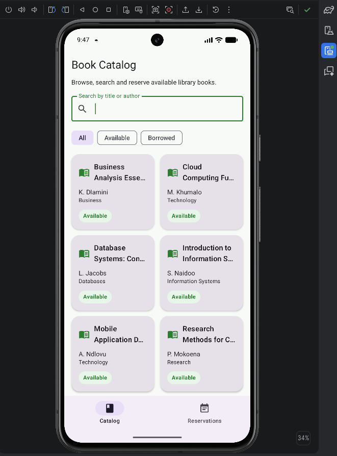
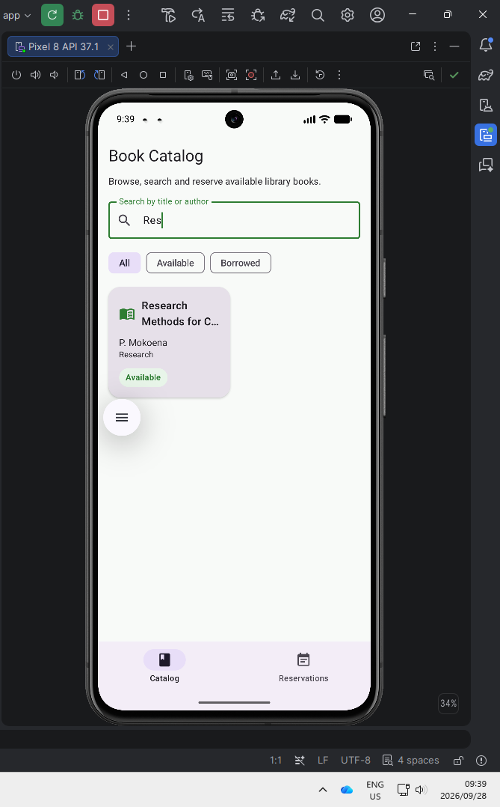
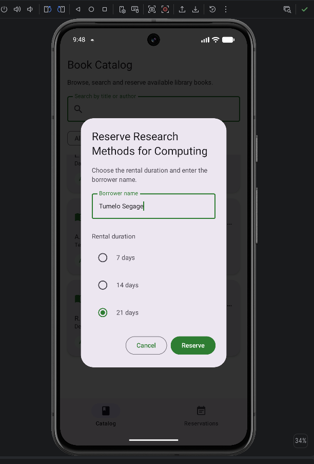
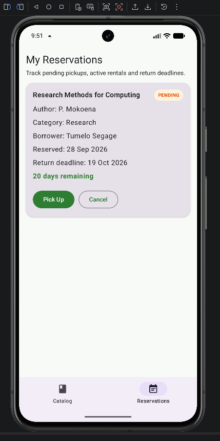
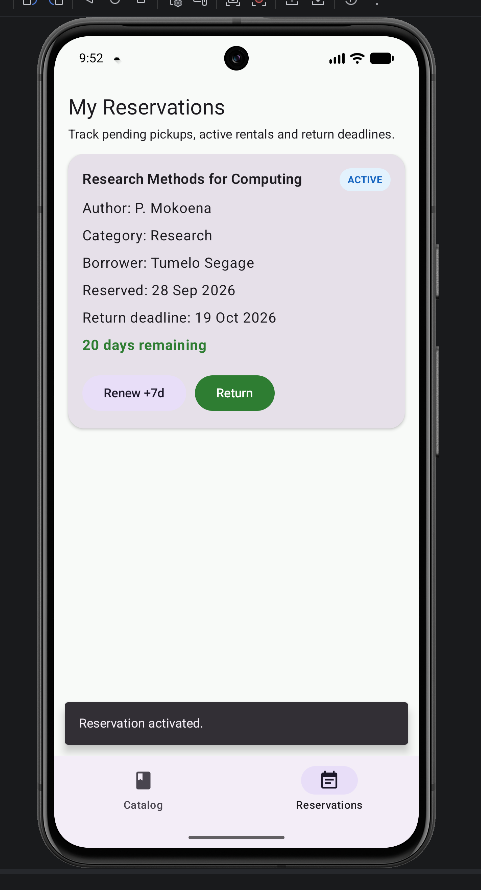
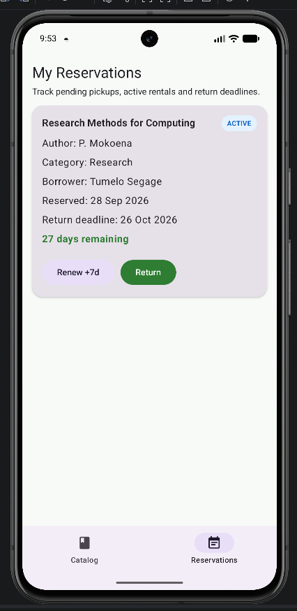
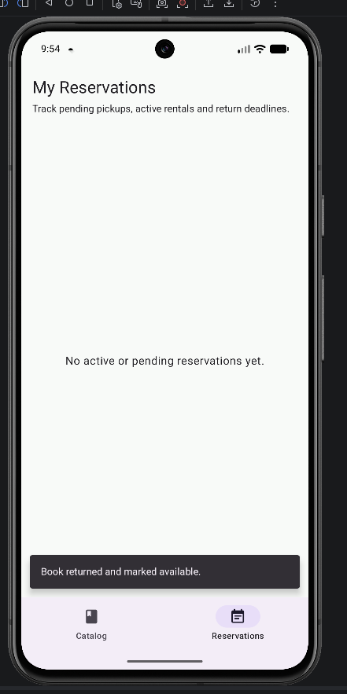
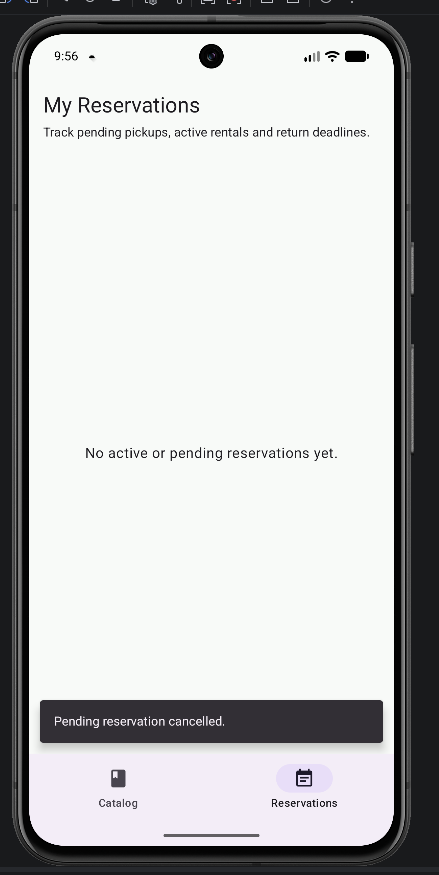

# Kitabu - Library Book Rental & Reservation System

**Module:** Mobile Application Development B  
**Module Code:** MADB372  
**Assessment:** SF1  
**Application Name:** Kitabu  
**Developer:** Tumelo Segage  

---

## Project Overview

Kitabu is a native Android Library Book Rental and Reservation System developed for the MADB372 SF1 assessment.

The application is designed to improve the management of academic library resources by allowing users to browse available books, search for books, reserve titles, manage their reservations, and keep track of return deadlines directly from an Android device.

The application was developed using Kotlin, Jetpack Compose, Room Database, MVVM architecture, Kotlin Coroutines, Flow, StateFlow, and Navigation Compose.

---

## Technologies Used

The Kitabu application uses the following technologies:

- Kotlin
- Android Studio
- Jetpack Compose
- Material 3
- Room Database
- SQLite
- MVVM Architecture
- Kotlin Coroutines
- Kotlin Flow
- StateFlow
- Navigation Compose
- KSP
- ViewModel
- Git
- GitHub

---

## Main Features

### Book Catalogue

The Book Catalogue displays available library books in a responsive Jetpack Compose layout.

Each book displays:

- Book title
- Author
- Category
- Availability status

Books are visually identified using availability badges.

- **Available** books are displayed with a green status badge.
- **Borrowed/Reserved** books are displayed with a different status indicator.

---

### Search Functionality

Users can dynamically search for books by:

- Book title
- Author

The search functionality uses Room database queries and updates the displayed catalogue according to the search text entered by the user.

---

### Book Filtering

Users can filter books using the following options:

- All
- Available
- Borrowed

This makes it easier to identify books according to their current availability.

---

### Book Reservation

When a user selects an available book, a reservation dialog is displayed.

The user can:

- Select a rental duration
- Confirm the reservation
- Cancel the reservation dialog

After a successful reservation, the book's availability is updated automatically.

---

### Reservations Dashboard

The Reservations Dashboard displays the user's current book reservations.

Each reservation displays information such as:

- Book title
- Author
- Reservation date
- Return deadline
- Days remaining
- Reservation status

---

## Reservation Lifecycle

The application supports the complete reservation lifecycle.

### Pending Reservation

A newly created reservation can initially be stored as a pending reservation.

A pending reservation can be cancelled before it becomes active.

### Active Reservation

An active reservation represents a book currently being rented by the user.

The user can:

- Renew the rental
- Return the book

### Returned Reservation

When a book is returned:

- The reservation status is updated.
- The related book becomes available again.
- The Book Catalogue updates automatically.

---

## CRUD Functionality

Kitabu demonstrates full CRUD functionality using Room Database.

### Create

A new reservation is created when the user reserves an available book.

A new `BookingEntity` record is inserted into the Room database.

---

### Read

The application retrieves data from Room Database using Kotlin Flow.

The application can:

- Retrieve all books
- Retrieve available books
- Retrieve reservations
- Search books by title
- Search books by author
- Display reservation information

---

### Update

Database records are updated when the user:

- Renews a rental
- Activates a reservation
- Returns a book
- Changes the return deadline

Returning a book also updates the related book so that its availability becomes available again.

---

### Delete

A pending reservation can be cancelled.

Cancelling the reservation removes the relevant booking record and restores the book's availability.

---

## Architecture

Kitabu follows the **Model-View-ViewModel (MVVM)** architecture.

The application is divided into separate layers to improve maintainability, readability, and separation of concerns.

```text
Jetpack Compose UI
        |
        v
    ViewModel
        |
        v
    Repository
        |
        v
      DAO
        |
        v
 Room Database
```

---

## UI Layer

The UI Layer contains the Jetpack Compose screens and reusable interface components.

Its responsibilities include:

- Displaying books
- Displaying reservations
- Capturing user input
- Displaying search results
- Displaying reservation actions
- Navigating between application screens

---

## ViewModel Layer

The ViewModel manages application state and communicates between the UI and Repository layers.

The ViewModel:

- Exposes reactive application state
- Uses StateFlow
- Handles user actions
- Launches Coroutines
- Requests data through the Repository

---

## Repository Layer

The Repository provides an abstraction between the ViewModel and Room DAOs.

It is responsible for coordinating database operations such as:

- Reading books
- Searching books
- Creating reservations
- Updating reservations
- Returning books
- Renewing rentals
- Cancelling reservations

---

## Data Layer

The Data Layer contains the Room Database implementation.

It includes:

- `BookEntity`
- `BookingEntity`
- `BookDao`
- `BookingDao`
- Room database class
- Type converters

---

## Room Entities

### BookEntity

The `BookEntity` stores information about books.

Important fields include:

- `bookId`
- `title`
- `author`
- `category`
- `isAvailable`

---

### BookingEntity

The `BookingEntity` stores reservation information.

Important fields include:

- `bookingId`
- `bookOwnerId`
- `userName`
- `bookingDate`
- `returnDeadline`
- `status`

Booking status values include:

- `PENDING`
- `ACTIVE`
- `RETURNED`

---

## Room Database

Kitabu uses Room Database with SQLite for local data persistence.

The database stores book and reservation information locally on the Android device.

The database is pre-populated with sample academic books when it is first created.

This allows the application to display books immediately when the user launches the application for the first time.

---

## Reactive State Management

Room DAO queries return Kotlin `Flow`.

The ViewModel observes the Flow and exposes application state to the Jetpack Compose interface.

Compose screens observe this state so that changes to the database are reflected automatically in the user interface.

For example, when a user reserves or returns a book, the availability status displayed in the Book Catalogue updates automatically.

---

## Asynchronous Database Operations

Database write operations are performed asynchronously using Kotlin Coroutines.

Example:

```kotlin
viewModelScope.launch {
    // Room database operation
}
```

Using Coroutines prevents database transactions from blocking the Android Main/UI Thread.

---

## Navigation

Kitabu uses Navigation Compose with a single-activity architecture.

The application uses a `NavHost` and `NavController` to navigate between screens.

The main navigation destinations include:

- Catalog
- Reservations

---

## Input Validation

The application includes input validation to help prevent invalid data from being submitted.

Validation includes:

- Preventing invalid reservation actions
- Preventing invalid return dates
- Checking book availability before reservation
- Sanitising user input where necessary

---

## Project Structure

The main application structure follows a logical package organisation.

```text
app/
└── src/
    └── main/
        └── java/
            └── com/
                └── stadiolinks/
                    └── kitabu/
                        ├── data/
                        │   ├── local/
                        │   └── repository/
                        │
                        ├── di/
                        │
                        ├── domain/
                        │
                        ├── ui/
                        │   ├── components/
                        │   ├── navigation/
                        │   ├── screens/
                        │   └── theme/
                        │
                        ├── MainActivity.kt
                        └── KitabuApplication.kt
```

---

## Application Requirements

To run the project, the following are required:

- Android Studio
- JDK 17 or newer
- Android SDK
- Android API 26 or newer
- Android Emulator or physical Android device
- Internet connection for the initial Gradle dependency download

---

## How to Run the Application

1. Clone this repository to your computer.

2. Open Android Studio.

3. Select **Open**.

4. Open the `Kitabu_MADB372_SF1` project folder.

5. Allow Android Studio to complete Gradle synchronisation.

6. Start an Android Emulator or connect a physical Android device.

7. Select the `app` run configuration.

8. Click **Run**.

9. The Kitabu Book Catalogue screen will open.

---

## Testing

The application was tested using an Android emulator.

The following functionality was tested:

- Application launch
- Book catalogue display
- Searching by title
- Searching by author
- Book availability filtering
- Creating reservations
- Viewing reservations
- Cancelling pending reservations
- Renewing active rentals
- Returning books
- Updating book availability
- Room database persistence
- Navigation between screens

---

## Screenshots

### Book Catalogue



---

### Search and Filtering



---

### Reserve Book Dialog



---

### Reservations Dashboard



---

### Active Reservation



---

### Renew Book



---

### Return Book



---

### Cancel Reservation



---

## Key Learning Outcomes

The development of Kitabu demonstrates the practical use of:

- Kotlin Android development
- Declarative UI development with Jetpack Compose
- Room Database
- SQLite
- CRUD operations
- MVVM architecture
- Repository pattern
- Kotlin Coroutines
- Kotlin Flow
- StateFlow
- Reactive user interfaces
- Navigation Compose
- Local data persistence
- Android application testing
- Git and GitHub version control

---

## Assessment Information

**Institution:** STADIO Higher Education  
**School:** School of Information Technology  
**Module:** Mobile Application Development B  
**Module Code:** MADB372  
**Assessment:** SF1  
**Project:** Library Book Rental & Reservation System  
**Application Name:** Kitabu  

---

## Author

**Tumelo Segage**
